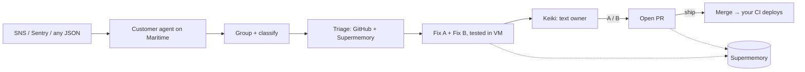

# Patchline

**Your app texts you when it breaks, with two tested fixes. Reply A to ship.**

Patchline is an on-call engineer in your messages. Point your alerts at it and connect your GitHub repo. When something breaks, Patchline investigates, writes two tested fixes, and texts you on iMessage or WhatsApp.

> 🔴 **myapp**: checkout failing for 12 users since 2:04pm
> Cause: Stripe webhook secret missing in `billing.ts` after the last deploy
> **A)** Read the secret from env with a clear error (4 lines, tests ✅)
> **B)** Add a startup config check for all secrets (31 lines, tests ✅)
> Reply A, B, "more", or "ignore"

Reply **A** → pull request. Reply **ship** → merged and deployed by your existing CI/CD.

## Why
Big companies have on-call rotations, PagerDuty and SREs. Indie devs and small teams have an inbox full of error emails, a laptop, and hours of lag before anyone looks. Patchline closes that gap: alert → diagnosis → tested fix → approval from your phone.

## How it works


1. **Ingest:** one URL per customer. Accepts generic JSON, AWS SNS, and Sentry webhooks.
2. **Group:** 200 identical errors become one incident. Info alerts become a one-line text or daily digest.
3. **Triage:** reads the stack trace, recent commits, relevant files, and past incidents.
4. **Two fixes:** a minimal patch and a robust one, each tested in an isolated VM.
5. **Text:** you get the diagnosis and both options.
6. **Reply:** `A`, `B`, `ship`, `more`, `ignore`, or just ask "what keeps breaking?"

## Built on
- **[Maritime](https://maritime.sh):** one isolated agent micro-VM per customer. Repos and secrets never mix, tests run sandboxed, agents sleep when nothing's broken.
- **[Keiki](https://onkeiki.com):** Patchline lives in iMessage, WhatsApp and SMS. Replies are Keiki tool calls.
- **[Supermemory](https://supermemory.ai):** remembers every incident and your choices. "Same as Oct 28, you chose A then."

## Setup (under 2 minutes)
1. Text **start** to the Patchline number, or sign up on the site.
2. Connect your GitHub repo with a fine-grained token (one repo; contents + pull requests).
3. Paste your ingest URL into SNS, Sentry, or your error handler. Send a test event. Your phone buzzes.

```bash
curl -X POST https://<your-agent>/ingest/<token> \
  -H 'content-type: application/json' \
  -d '{"service":"api","level":"error","message":"TypeError: x is undefined","stack":"at handler (src/billing.ts:42)"}'
```

## Safety
- Only your registered phone numbers can approve anything.
- A/B opens a PR. `ship` merges. Patchline never pushes to your default branch.
- PII and secrets are scrubbed before anything reaches the LLM, a PR, a text, or memory.
- No `ship` option on a failing PR.

## Development
```bash
npm install
cp .env.example .env
npm run dev
npm test
```
Design docs: [`docs/SYSTEM_DESIGN.md`](docs/SYSTEM_DESIGN.md) · [`docs/STACK.md`](docs/STACK.md)

## Roadmap
Email-forward ingest, Vercel and CloudWatch log drains, GitHub App install, team rotations.

---
Built for **FIRST 1000** by Keiki × Maritime.
