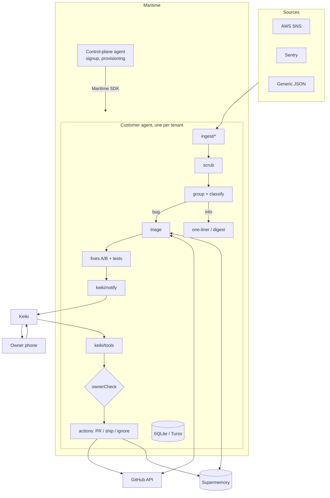
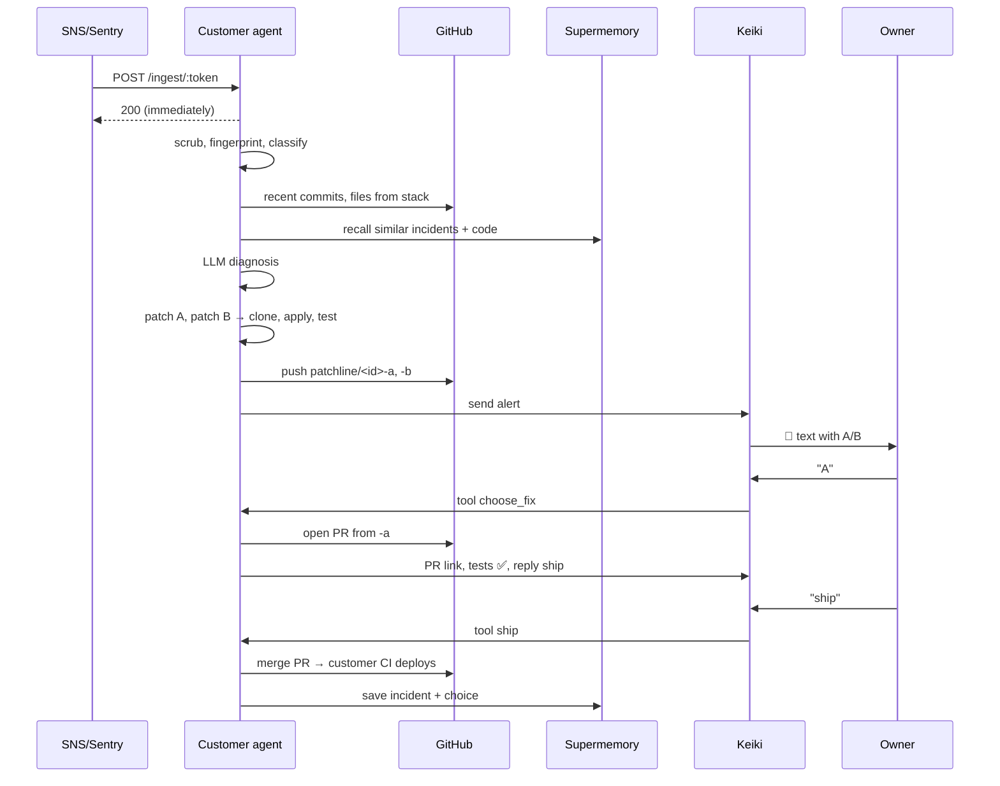

# System design

## Components


## Main flow


## Ingest formats
- **Generic:** `{service, level, message, stack?, count?, url?}`
- **SNS:** verify signature; on `SubscriptionConfirmation` GET `SubscribeURL`; on `Notification` parse `Message` (CloudWatch alarm JSON or app alert text).
- **Sentry:** webhook payload → message, top frames, count, url.
- **Email:** stretch.

All normalize to `AlertEvent {tenantId, source, sourceId, service, level, message, stack?, count, url?, receivedAt}`.

## Grouping
- **Fingerprint** = hash(normalized message + top in-repo stack frame). Normalize: strip numbers, hex, UUIDs, quoted strings, timestamps.
- Same fingerprint within 30 min of `last_seen` and status not terminal → bump `count`, no new text.
- Same fingerprint after `shipped` → new incident flagged **regression**.
- Muted fingerprints → drop.
- **Classify** (Haiku): `bug` (full A/B) or `info` (one-liner or daily digest). Level `error`/`fatal` with a stack defaults to bug.

## Triage
Inputs: scrubbed error + stack, last ~10 commits on default branch, contents of files named in the stack (cap ~4 files), Supermemory recall (code + past incidents).
Output (Zod-validated): `{cause, files[], impact, since, confidence: low|med|high}`.
Low confidence → text says so and offers `more`, still produces fixes if possible.

## Fixes
1. LLM → `{files:[{path, content}], summary}` for **A** (minimal) and **B** (robust). Full contents, not diffs.
2. In the VM: shallow clone → branch `patchline/<id>-a` → write files → `npm ci` (cache between runs) → `TEST_CMD` in `TEST_DIR` (NotchMan: `server/`) → record pass/fail + last 30 log lines.
3. Push both branches. Count changed lines.
4. If both fail: text the diagnosis and say neither passed; offer `more` only.

## Incident lifecycle
```
open → triaging → fixes_ready → pr_open → shipped
            ↘ failed      ↘ ignored
```

## Data model
```sql
CREATE TABLE tenants (
  id TEXT PRIMARY KEY, name TEXT, repo TEXT NOT NULL,
  default_branch TEXT NOT NULL DEFAULT 'main',
  owner_phones TEXT NOT NULL,          -- JSON array, E.164
  ingest_token TEXT UNIQUE NOT NULL,
  test_cmd TEXT NOT NULL DEFAULT 'npm test', test_dir TEXT NOT NULL DEFAULT '.',
  keiki_conversation_id TEXT, created_at INTEGER NOT NULL
);
CREATE TABLE incidents (
  id INTEGER PRIMARY KEY AUTOINCREMENT, tenant_id TEXT NOT NULL,
  fingerprint TEXT NOT NULL, kind TEXT NOT NULL,       -- bug | info
  status TEXT NOT NULL, title TEXT NOT NULL, regression INTEGER DEFAULT 0,
  count INTEGER NOT NULL DEFAULT 1, first_seen INTEGER NOT NULL, last_seen INTEGER NOT NULL,
  diagnosis TEXT                                        -- JSON
);
CREATE TABLE fixes (
  incident_id INTEGER NOT NULL, variant TEXT NOT NULL, -- A | B
  branch TEXT, summary TEXT, lines_changed INTEGER,
  tests TEXT NOT NULL DEFAULT 'pending',               -- pending | pass | fail | skipped
  test_log_tail TEXT, pr_number INTEGER, pr_url TEXT,
  PRIMARY KEY (incident_id, variant)
);
CREATE TABLE mutes (tenant_id TEXT, fingerprint TEXT, PRIMARY KEY (tenant_id, fingerprint));
CREATE TABLE seen (key TEXT PRIMARY KEY, at INTEGER NOT NULL); -- SNS MessageId, Keiki message id
```

## Keiki tools
| Tool | Args | Does |
|---|---|---|
| `list_incidents` | `status?` | Recent incidents (also used by the polling fallback) |
| `get_incident` | `id` | Diagnosis + fix summaries |
| `choose_fix` | `id?, variant` | Opens PR from that branch |
| `ship` | `id?` | Merges PR; refuses if tests not ✅ |
| `ignore` | `id?` | Mutes fingerprint |
| `explain_more` | `id?` | Full diagnosis + diff summary |
| `weekly_summary` | — | Supermemory-backed "what keeps breaking" |

`id` omitted → latest incident in `fixes_ready` (or `pr_open` for `ship`). Every tool: verify Keiki secret → dedupe message id → `ownerCheck` → act.

## Message templates
- **Alert:** see README example. Only show `tests ✅` variants as shippable.
- **PR opened:** `PR #12 open (A, tests ✅): <url>. Reply ship to merge.`
- **Shipped:** `Merged #12. Your CI is deploying. I'll watch for this error again.`
- **Info:** `ℹ️ myapp: budget at 80% (3 today)`; batched into digest if more than 3/hour.

## Multi-tenancy
- **Target:** one Maritime agent per customer, created by the control plane via SDK. Isolation of repos, tokens, test runs.
- **Demo:** control plane + NotchMan agent + sample-app agent. Provisioning can be manual if time is short.
- **Fallback:** single shared agent with `tenant_id` on every row and `containerTag` per tenant.

## Security
- Owner check on every action. Unknown senders get no reply.
- Keiki requests verified with shared secret; SNS with signature; ingest with per-tenant unguessable token.
- Scrub before LLM, PR body, texts, memory, logs.
- Fine-grained GitHub token, one repo. Never push to default branch. Merge only via PR.
- Secrets only in Maritime secrets; redacted from logs.

## Failure modes
| Failure | Handling |
|---|---|
| LLM returns invalid JSON | Zod fail → one retry → text diagnosis only |
| Patch fails tests | Mark ❌, don't offer ship |
| Test run exceeds 5 min | Kill, mark `skipped`, say so |
| GitHub API error / token expired | Text owner: "can't reach repo, reconnect" |
| Merge conflict on ship | Text "conflict, needs a human" with PR link |
| Keiki can't push | Schedule polls `list_incidents` |
| VM disk not persistent | `DATABASE_URL` → Turso |
| Alert storm | Grouping + 1 text per incident + digest for info |

## Targets
Text within **3 minutes** of the error. Ingest response under 200 ms.
